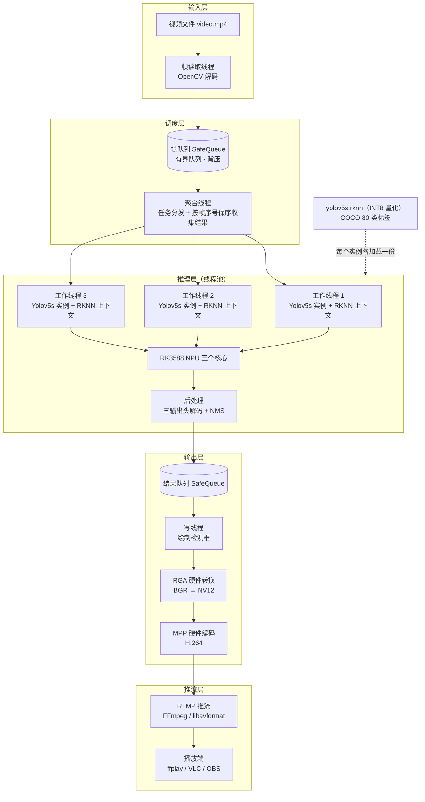

<div align="center">

# RK3588 边缘 AI 目标检测与推流系统

**在香橙派 / RK3588 开发板上，用 NPU 三核并行跑 YOLOv5s 目标检测，检测结果经硬件编码后实时 RTMP 推流——全程在板子上完成，不依赖云端。**


[English summary ↓](#english-summary)

</div>

## 整体架构



## 项目简介

这是一个运行在瑞芯微 RK3588（以香橙派 Orange Pi 5 为代表）开发板上的**完整视频目标检测流水线**：读取视频 → YOLOv5s 目标检测 → 绘制检测框 → 硬件编码 → RTMP 实时推流，全部在板端完成。

为什么做这个：RK3588 的 NPU 有三个核心、算力 6 TOPS，是国产边缘 AI 芯片里非常有代表性的一块。但网上大多数 RK3588 示例只演示"拿一张图片调一次推理"，离真实应用差得很远——真实场景要的是**持续的帧流、并行推理、顺序正确的输出、以及能直接看的视频流**。这个项目把这条链路完整打通，可以直接当作边缘视觉应用的参考实现：安防摄像头分析、边缘盒子视频结构化、机器人/无人车感知原型，都可以在这个骨架上改。

## 核心特性

- **NPU 三核真并行推理**：线程池中每个工作线程持有一个独立的 RKNN 上下文，三个线程分别绑定 NPU 的三个核心（`RKNN_NPU_CORE_0/1/2`），三帧同时推理，而不是单核串行。
- **并行但不乱序**：并行推理的完成顺序是不确定的，聚合线程用「帧序号 → future」的映射表收集结果，只按原始帧序向下游释放，最多允许 10 帧在途——吞吐拉满的同时，输出视频的帧序永远正确。
- **全硬件媒体链路**：RGA 负责 BGR → NV12 格式转换，Rockchip MPP 负责 H.264 硬件编码（码率/GOP 按输入帧率自动计算），FFmpeg 负责 RTMP 封装推流。CPU 只负责调度和搬运，不做重活。
- **有界队列背压**：流水线各阶段之间用线程安全的有界队列连接（默认深度 5），生产快于消费时自动阻塞，内存占用恒定，长时间运行不涨内存。
- **INT8 量化模型开箱即用**：仓库自带量化好的 `yolov5s.rknn`（约 9.4 MB），兼容 COCO 80 类，三输出头的解码与逐类别 NMS 后处理全部用 C++ 实现，无 Python 依赖。
- **工程化结构**：捕获、调度、推理、输出四段解耦，线程池基于 `std::future` 异步提交，改输入源或换模型都不用动流水线骨架。

## 架构详解

| 阶段 | 线程/组件 | 职责 |
|---|---|---|
| 捕获 | 帧读取线程 | OpenCV 打开视频文件，逐帧解码后送入帧队列 |
| 调度 | 聚合线程 | 从帧队列取帧，包成任务提交线程池；维护在途 future 表，按帧序取回结果 |
| 推理 | 线程池（默认 3 线程） | 每线程一个 Yolov5s 实例：缩放至 640×640 → RKNN 推理 → 后处理解码三个 INT8 输出头 → NMS |
| 输出 | 写线程 | 在帧上绘制检测框和类别标签 → RGA 转 NV12 → MPP 编码 H.264 → 推流 |

**并行保序机制**：每个任务提交时带上自增的帧序号，返回的 `std::future` 按序号存入映射表；聚合线程只从最小序号开始依次取已完成的结果，某帧没算完就等它，绝不跳过。这样无论三核谁先算完，输出永远是 1、2、3……的顺序。

**编码参数**：帧率取自输入视频，GOP = 2 × 帧率；码率按分辨率与帧率自动估算；支持 Baseline / Main / High 三种 H.264 profile 配置（见 `mpp.h`）。

## 快速开始

### 环境要求

| | |
|---|---|
| **硬件** | RK3588 / RK3588S 开发板（如香橙派 Orange Pi 5） |
| **系统** | aarch64 Linux，需带 Rockchip MPP 驱动 |
| **工具** | CMake ≥ 3.5、C++14 编译器、pkg-config |
| **依赖库** | OpenCV、FFmpeg（libavcodec / libavformat / libavutil / libswscale）、rockchip_mpp |
| **已内置** | RKNN 运行时（`librknnrt`）与 RGA 库在 `3rdparty/` 中（aarch64），克隆即可用，无需另装 |

### 构建与运行

```bash
git clone https://github.com/Palmyaen/orangepi.git
cd orangepi
mkdir build && cd build
cmake ..
make -j$(nproc)
./app        # 在 build 目录下运行（路径相对 build 目录解析）
```

### 输入与输出配置（重要）

输入视频路径和推流地址在 `include/videofile.h` 里配置：

```cpp
static const std::string VIDEO_PATH = "../video.mp4";  // 输入视频
static const std::string STREAM_URL = "";              // 推流地址，默认空
```

- 把任意测试视频放到仓库根目录命名为 `video.mp4`（或改 `VIDEO_PATH`）；
- `STREAM_URL` 出厂默认为空，此时只做本地编码流程；填上你自己的 RTMP 地址（如 `rtmp://<你的服务器>:1935/live/app`）即启用推流，服务端可用 nginx-rtmp、SRS、MediaMTX 等，播放端用 ffplay / VLC / OBS 打开同一地址即可观看带检测框的实时画面。

## 配置说明

| 配置项 | 位置 | 默认值 | 说明 |
|---|---|---|---|
| 输入视频 / 推流地址 | `include/videofile.h` | `../video.mp4` / 空 | 见上文 |
| 推理工作线程数 | `main.cpp`（`ThreadPoll` 参数） | 3 | 对应 NPU 三个核心，一般不改 |
| 最大在途帧数 | `main.cpp`（`MAX_CONCURRENT_FRAMES`） | 10 | 越大吞吐越高、延迟越大 |
| 队列深度 | `SafeQueue.h` 构造参数 | 5 | 各阶段间的缓冲与背压 |
| 框置信度 / NMS 阈值 | `include/post_process.h` | 0.5 / 0.5 | 漏检多调低前者，重复框多调高后者 |

## 目录结构

| 文件 | 作用 |
|---|---|
| `main.cpp` | 流水线装配：读取 / 聚合 / 写三条线程的组织 |
| `thread_poll.*` | 线程池：每线程持一个 Yolov5s 实例，异步提交推理任务 |
| `yolov5s.*` | RKNN 模型封装：加载、推理、绘制检测结果 |
| `post_process.*` | YOLOv5 三输出头解码 + 逐类别 NMS |
| `SafeQueue.h` | 线程安全有界队列 |
| `streamer.*` / `mpp.*` | MPP H.264 硬件编码与码流管理 |
| `rtmp.*` | 基于 FFmpeg 的 RTMP 推流 |
| `model/` | `yolov5s.rknn`（INT8）+ COCO 80 类标签文件 |
| `3rdparty/` | RKNN 运行时与 RGA 库（aarch64） |

## 常见问题

**Q：编译时找不到 `rockchip_mpp` 或 OpenCV？**
A：确认在 RK3588 板子的 Linux 系统里编译（本项目面向 aarch64 板端构建，不是在 PC 上交叉编译的配置）；MPP 随瑞芯微 BSP / 系统镜像提供，OpenCV 与 FFmpeg 用系统包管理器安装开发包即可。

**Q：程序跑起来了，但没有推流画面？**
A：先确认 `include/videofile.h` 的 `STREAM_URL` 已填你的 RTMP 地址并重新编译；再确认推流服务器在运行、播放端地址与推流地址一致。

**Q：检测框位置不对 / 漏检很多？**
A：本项目输入帧直接缩放至 640×640（非等比 letterbox），宽高比差异大的视频框位置会有拉伸偏差；漏检可尝试调低 `post_process.h` 中的 `BOX_THRESH`。

**Q：能接摄像头或 RTSP 流吗？**
A：当前版本输入为视频文件。把读取线程的 `cv::VideoCapture` 打开方式换成设备号或 RTSP 地址即可接入，已列入路线图。

## 路线图

- [ ] 摄像头 / RTSP 输入支持
- [ ] 接通本地 `output.avi` 录像输出（`main.cpp` 中已有骨架，尚未接入主链路）
- [ ] 配置文件化（替代硬编码路径）
- [ ] 支持更新的模型（YOLOv8 / YOLO11）

欢迎提 Issue 和 PR，参与方式见 [CONTRIBUTING.md](CONTRIBUTING.md)。

## English Summary

End-to-end C++ edge-AI pipeline on Rockchip RK3588 (Orange Pi 5): a thread pool runs YOLOv5s (INT8 RKNN, COCO 80 classes) across all three NPU cores in parallel; an aggregator keeps results in frame order (up to 10 frames in flight); a writer stage draws detections, converts BGR → NV12 with RGA, hardware-encodes H.264 with Rockchip MPP, and streams over RTMP via FFmpeg. Bounded thread-safe queues provide backpressure between stages. Build: CMake, C++14, OpenCV, FFmpeg, rockchip_mpp; RKNN runtime and RGA libraries for aarch64 are bundled under `3rdparty/`. Input video path and RTMP URL are configured in `include/videofile.h`.

## 许可证

[MIT](LICENSE) © Hanzhe Xiao
