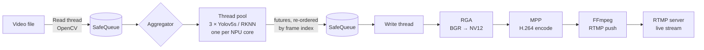

<div align="center">

# YOLOv5s Edge-AI Pipeline for RK3588

**Real-time object detection on the Rockchip RK3588 NPU — parallel 3-core inference, hardware encoding, live RTMP streaming. One board, zero cloud.**


</div>

Complete, working RK3588 NPU examples are surprisingly scarce — most material online covers a single inference call on a still image. This project is the missing end-to-end reference: a full video pipeline that reads frames, runs YOLOv5s detection across **all three NPU cores in parallel**, keeps the output in frame order, hardware-encodes the annotated video, and pushes it out as a live RTMP stream.

<!-- Demo: record a short clip of the output stream (OBS / ffplay) and add it here as docs/demo.gif — a moving demo is the single most persuasive thing on this page. -->

## Highlights

- **3-core NPU parallelism** — a thread pool holds one RKNN context per worker thread (3 by default, one per RK3588 NPU core). Frames are inferred concurrently instead of one by one.
- **Order-preserving concurrency** — an aggregator thread tracks in-flight futures by frame index (up to 10 in flight) and releases results in the original sequence, so parallelism never scrambles the output stream.
- **Hardware pipeline end to end** — RGA converts BGR → NV12, Rockchip MPP hardware-encodes H.264 (GOP = 2 × fps), FFmpeg/libavformat muxes and pushes RTMP. The CPU mostly moves frames between bounded, thread-safe queues.
- **Production-shaped C++** — `std::future`-based task submission, bounded queues with backpressure, clean separation between capture, inference, and streaming stages.
- **INT8 YOLOv5s** — quantized RKNN model (`model/yolov5s.rknn`, ~9.4 MB), COCO 80 classes, three detection heads with C++ NMS post-processing.

## Architecture



## Requirements

| | |
|---|---|
| **Board** | RK3588 / RK3588S board, e.g. Orange Pi 5 |
| **OS** | Linux on aarch64 with Rockchip MPP drivers |
| **Build tools** | CMake ≥ 3.5, C++14 compiler, pkg-config |
| **Libraries** | OpenCV, FFmpeg (`libavcodec` / `libavformat` / `libavutil` / `libswscale`), `rockchip_mpp` |
| **Bundled** | RKNN runtime (`librknnrt`) and RGA libraries for aarch64 under `3rdparty/` — no separate install needed |

## Build & Run

```bash
git clone https://github.com/Palmyaen/orangepi.git
cd orangepi
mkdir build && cd build
cmake ..
make -j$(nproc)
```

Paths are relative to the build directory:

- **Input video:** `../video.mp4` — drop any test video at the repo root (or edit the path in `main.cpp`)
- **Model:** `../model/yolov5s.rknn` — already in the repo
- **Run:** `./app`

Before running, set your own RTMP target in `main.cpp` (default `rtmp://192.168.2.20:1935/live/app`) — any RTMP server works (nginx-rtmp, SRS, MediaMTX, …). Play the stream with ffplay / VLC / OBS at the same URL.

## Configuration

| What | Where | Default |
|---|---|---|
| Input path & RTMP URL | `main.cpp` | `../video.mp4`, `rtmp://192.168.2.20:1935/live/app` |
| Inference worker threads | `main.cpp` (`ThreadPoll` argument) | 3 |
| Max frames in flight | `main.cpp` (`MAX_CONCURRENT_FRAMES`) | 10 |
| Box / NMS thresholds | `post_process.h` | 0.5 / 0.5 |

## Project Structure

| File | Role |
|---|---|
| `main.cpp` | Pipeline wiring: read / aggregate / write threads, RGA color conversion |
| `thread_poll.*` | Thread pool holding one YOLOv5s instance per worker |
| `yolov5s.*` | RKNN model wrapper: load, infer, draw detections |
| `post_process.*` | YOLOv5 output decoding + NMS for the three INT8 heads |
| `SafeQueue.h` | Bounded thread-safe queue between pipeline stages |
| `streamer.*`, `mpp.*` | MPP H.264 hardware encoding |
| `rtmp.*` | RTMP muxing / pushing via FFmpeg |
| `model/` | `yolov5s.rknn` (INT8) + COCO 80-class label list |
| `3rdparty/` | RKNN runtime and RGA libraries (aarch64) |

## Roadmap

- [ ] Camera / RTSP input (currently file input)
- [ ] Wire up the local `output.avi` recording scaffolded in `main.cpp`
- [ ] Config file instead of hard-coded paths
- [ ] Support for newer models (YOLOv8 / YOLO11)

Contributions and issues are welcome — see [CONTRIBUTING.md](CONTRIBUTING.md).

## License

[MIT](LICENSE) © Hanzhe Xiao

## 中文简介

在香橙派等 RK3588 开发板上运行的 YOLOv5s 目标检测完整流水线：线程池并行调用 NPU 的三个核心做推理（每个工作线程持有一个 RKNN 上下文），聚合线程按帧序整理并行推理结果，写线程经 RGA 做 BGR → NV12 转换、MPP 硬件 H.264 编码，再通过 RTMP 实时推流。模型为 INT8 量化的 YOLOv5s（COCO 80 类）。构建与配置方法见上文。
